# EDR: Detección e Investigación en Endpoints con Wazuh + Sysmon
### EDR: Endpoint Detection & Investigation with Wazuh + Sysmon

**Autor:** Jorge Andrés Araya Chinchilla

**Fecha:** Octubre 2026

### Resumen

Este es el proyecto 4 de mi portafolio de ciberseguridad. Estoy aprendiendo y practicando detección y respuesta en endpoints como lo hace de verdad un analista SOC: generar comportamiento de ataque realista en un equipo Windows, detectarlo con un stack de EDR, investigar cada alerta y responder aislando el equipo.

Mi plan original era usar Microsoft Defender for Endpoint, pero mi tenant de Microsoft 365 no ofrece prueba de ese producto. Lo hice con **Wazuh + Sysmon**, y terminó siendo un mejor ejercicio de aprendizaje justo por ser open source  tuve que escribir mi propia regla de detección cuando encontré un hueco, en vez de depender de la lógica de un proveedor que no podía tocar.

### Arquitectura del laboratorio

| Equipo | Rol | IP |
|---|---|---|
| Kali Linux | Manager, indexer y dashboard de Wazuh | 192.168.56.101 |
| AD-Victim-Win11 | Endpoint monitoreado (agente Wazuh + Sysmon) | 192.168.56.103 |

VirtualBox, red Host-Only. Wazuh 4.9.2, Sysmon con la configuración de SwiftOnSecurity. El agente recolecta los logs operacionales de Sysmon, Windows Defender y PowerShell.

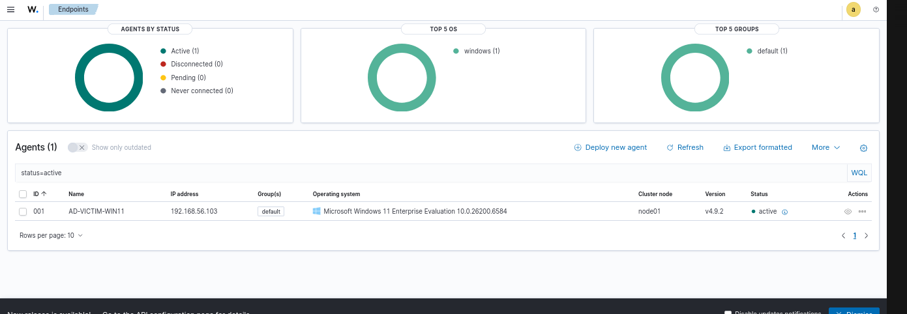
Agente conectado y activo en Wazuh.

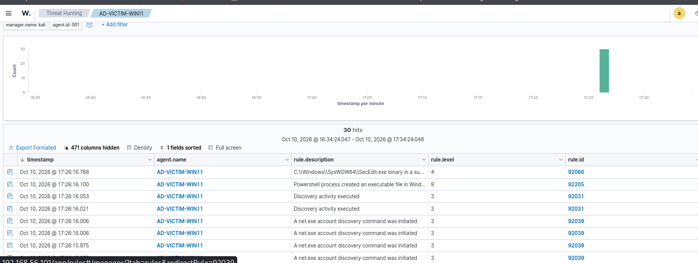
Eventos de Sysmon llegando al dashboard.

### Simulaciones de ataque

Ejecuté cinco simulaciones cubriendo distintas técnicas de MITRE ATT&CK, investigué cada alerta en el dashboard de Wazuh (árbol de procesos, proceso padre, línea de comandos, usuario) y registré el resultado.

**1. Comando de PowerShell codificado en Base64 — T1059.001.** Detectado  regla 92057, nivel 12.

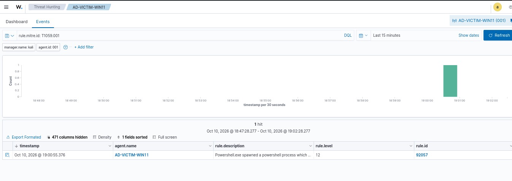
PowerShell codificado detectado.

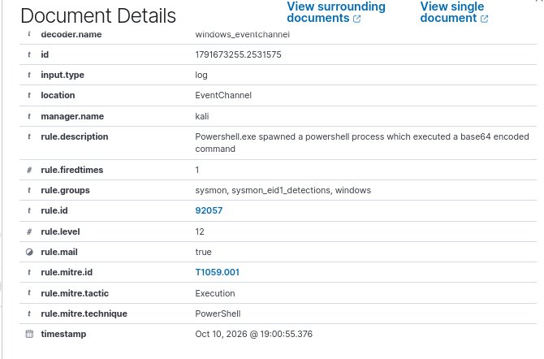

Mapeo MITRE para T1059.001.

**2. Persistencia por clave Run — T1547.001.** Detectado — regla 92302, nivel 6.

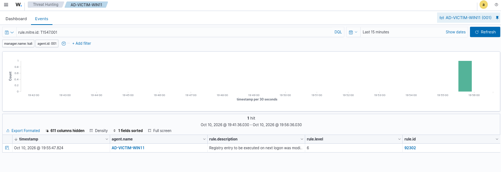
Persistencia por clave Run detectada.

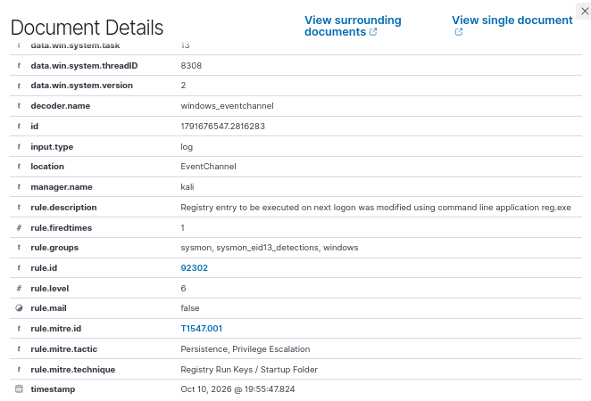
Mapeo MITRE para T1547.001.

**3. Persistencia por tarea programada  T1053.005.** Sysmon registró bien la creación de la tarea programada, pero las reglas por defecto de Wazuh no la detectaban. Escribí una regla propia para `schtasks.exe /create` y la mapeé a T1053.005. Volví a correr la simulación y la alerta saltó.

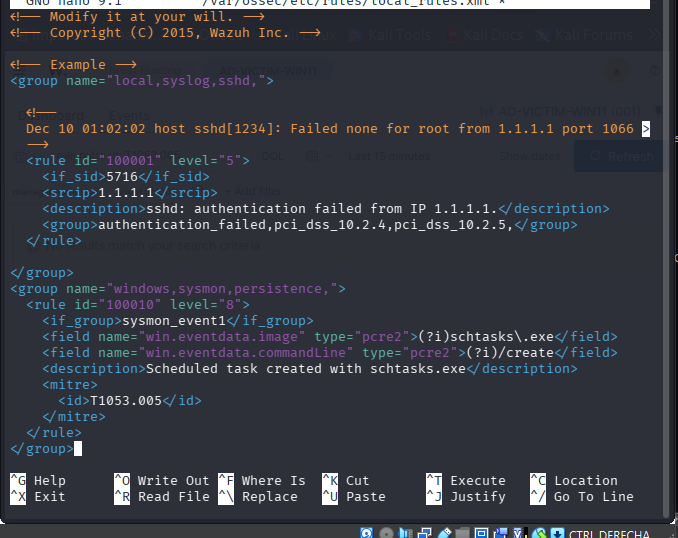
Regla personalizada escrita en Wazuh.

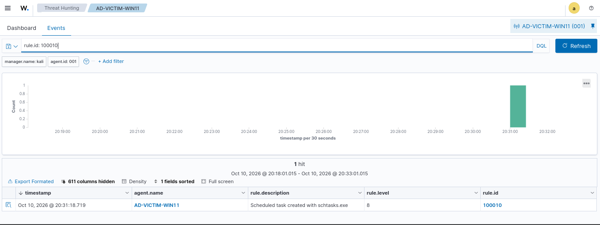
Tarea programada detectada tras el fix.

**4. Descubrimiento de cuentas y privilegios (`whoami /all`, `net user`)  T1087 / T1033.** Detectado  reglas 92031/92033, nivel 3.

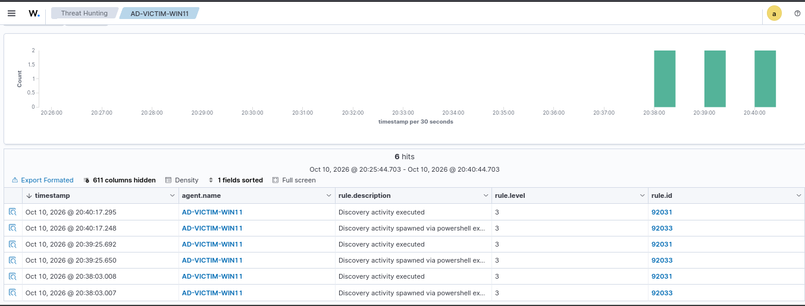
Descubrimiento de cuentas detectado.

**5. Intento de acceso a la memoria de LSASS  T1003.001.** Intenté volcar la memoria de LSASS desde el Administrador de tareas, hasta como administrador  me dio "Acceso denegado". Windows lo bloqueó a nivel de sistema operativo (LSASS Protection) antes de que Sysmon tuviera algo que registrar. No hubo alerta, pero eso no es lo mismo que una brecha: el ataque nunca llegó a pasar.

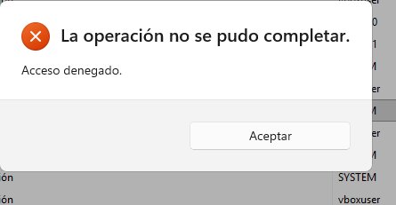
Volcado de LSASS bloqueado por Windows.

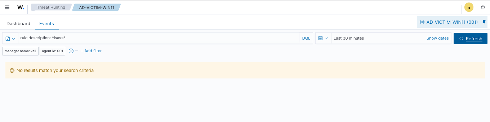
Sin telemetría para el intento de LSASS.

### Respuesta a incidentes — aislamiento del host

Para simular la contención de un endpoint comprometido, aislé a AD-Victim-Win11 a nivel de red manteniendo su reporte a Wazuh:

- Cambié la política por defecto de salida del Firewall de Windows a **Block** en todos los perfiles.
- Agregué una regla explícita de **Allow** solo para el tráfico saliente hacia el manager de Wazuh (192.168.56.101, puerto 1514).
- Verifiqué: las conexiones a cualquier otro host fallaban, mientras el agente de Wazuh seguía enviando eventos — lo confirmé con `Test-NetConnection` y viendo que el agente seguía en estado "Active" en el dashboard.
- Revertí ambos cambios al terminar.

Mi primer intento no funcionó como esperaba. Creé dos reglas: una que bloqueaba todo el tráfico saliente, y otra que permitía el tráfico hacia el servidor de Wazuh. Pensé que la regla de "permitir" iba a actuar como excepción,  no fue así. En el Firewall de Windows, una regla de bloqueo siempre gana sobre una de permiso, sin importar cuál creaste primero ni en qué orden las pusiste. Entonces, en vez de tener dos reglas peleando entre sí, borré la de "bloquear todo" y cambié la *política por defecto* de salida del perfil a Block. Esa política por defecto solo actúa cuando ninguna regla específica coincide con la conexión  así que mi única regla explícita de "permitir Wazuh" sigue funcionando, y todo lo demás queda bloqueado por defecto.

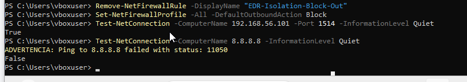
Host aislado, la conexión con Wazuh sigue abierta.

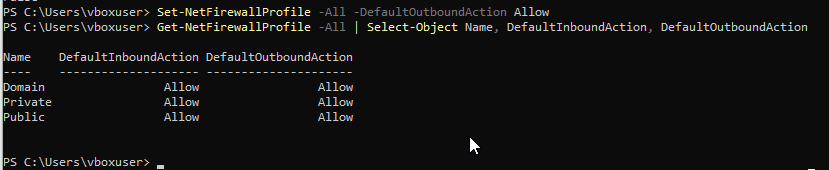
Firewall revertido a la normalidad.

### Lecciones aprendidas

- Lo más útil del proyecto no fue correr los ataques, sino notar el que no disparó ninguna alerta y tener que averiguar por qué, para después arreglarlo de verdad.
- Una alerta ausente no siempre significa una brecha de detección. A veces otra capa ya frenó el ataque, y tuve que revisarlo antes de asumir que Wazuh había fallado.
- El Firewall de Windows no se comporta como una lista ordenada simple de reglas. Tuve que entender cómo interactúan las reglas de bloqueo y permiso con la política por defecto antes de que el aislamiento funcionara de verdad.

### Habilidades demostradas

- Despliegue y resolución de problemas de un stack SIEM/EDR open source (Wazuh) y telemetría de endpoint (Sysmon)
- Lectura y correlación de eventos de Sysmon (creación de procesos, registro, red) para reconstruir el comportamiento de un ataque
- Mapeo de actividad observada a MITRE ATT&CK
- Escritura de una regla de detección personalizada en Wazuh para cerrar una brecha de cobertura
- Distinción entre una brecha real de detección y un control de prevención funcionando
- Contención de un host a nivel de red sin perder visibilidad de monitoreo
